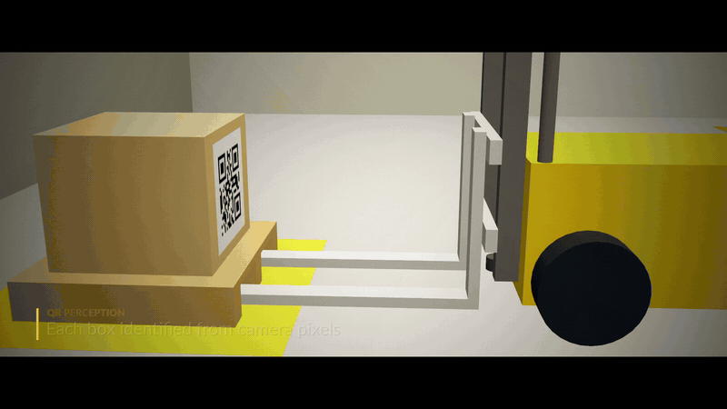
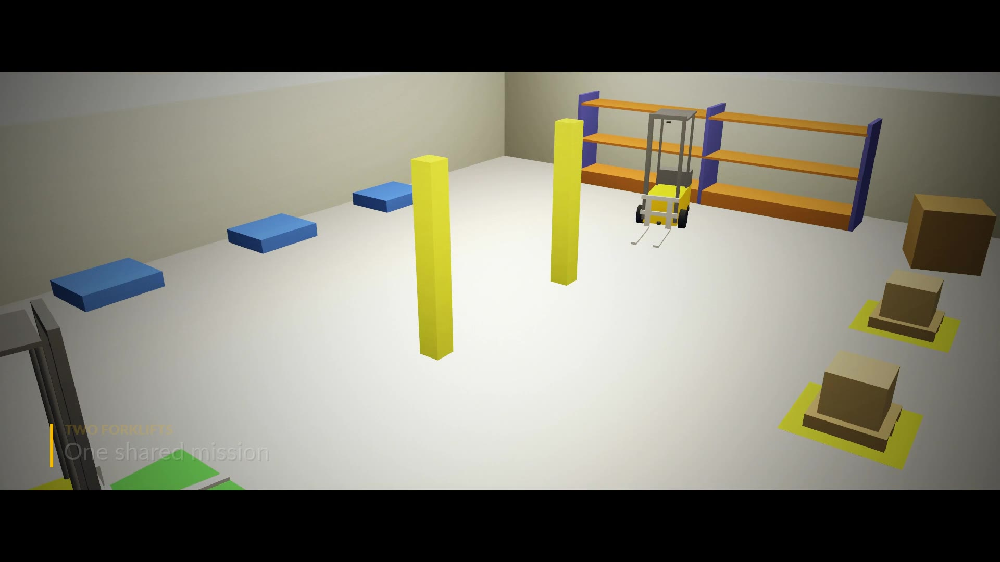
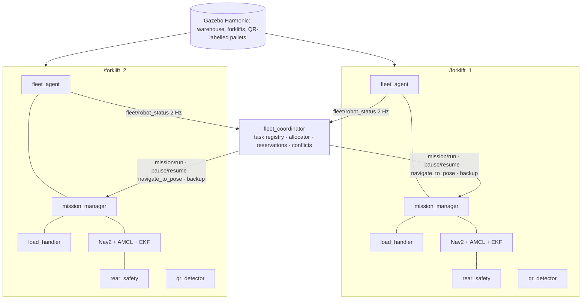

# ROS 2 Gazebo Multi-Forklift Fleet

This project is a multi-robot warehouse simulation. It uses **ROS 2 Jazzy** and
**Gazebo Sim (Harmonic)**. Two autonomous forklifts operate in one warehouse.

A fleet coordinator gives three QR-labelled boxes to the two forklifts. Each forklift does
these steps:

1. It reads the QR code with its camera.
2. It moves to the pallet with Nav2.
3. It lifts the pallet with a physically actuated fork.
4. It puts the pallet on the destination that the QR code gives.

The coordinator prevents path, zone and reverse-motion conflicts between the forklifts.

The simulator does not move the loads. The forks go into the pallet pockets and lift the
pallet by contact. Each forklift uses only its own sensors: a camera, a front LiDAR, a rear
LiDAR, an IMU and wheel odometry.

<p align="center">
  
</p>

## Film

[](docs/media/forklift_fleet_film.mp4)

**[▶ Watch the full film (1 min 56 s, 1080p)](docs/media/forklift_fleet_film.mp4)**

The film shows one continuous run of the two-forklift mission. Eight synchronized Gazebo
cameras recorded the run:

* One fixed wide camera
* One top-down camera
* Two low cameras along the pickup row and the shelf row
* One orbit camera
* One chase camera for each forklift
* One tracking camera at fork level

The cameras have no collision. They send data only to the recorder. Thus they have no effect
on the forklifts.

**[▶ Multi-angle time-lapse (4 synchronized cameras, 6x speed)](docs/media/multi_angle_timelapse.mp4)**

Result of the recorded run: `MISSION_COMPLETE: delivered 3/3 (BOX_A, BOX_B, BOX_C) in 382 s; 0 conflicts`.
forklift_1 delivered BOX_A. forklift_2 delivered BOX_C and then BOX_B.

## Functions

| Function | Method |
|---|---|
| Multi-robot fleet | Each forklift starts from one `robot.launch.py` with its own namespace and TF prefix. A central fleet coordinator has a task registry (one owner for each box), cost-based allocation, zone reservations and a heartbeat protocol. |
| Conflict control | The coordinator finds path, head-on, zone and rear-blocked conflicts. It uses fixed right-of-way rules and deadlock recovery. Each costmap shows the other forklifts from their heartbeats, because the fork tines are below the LiDAR plane. |
| Perception | OpenCV decodes the QR codes from the camera pixels. The node compares the payload with the mission. Planar PnP gives the pallet pose (±13 mm). |
| Navigation | A saved map, AMCL and Nav2. The footprint includes the forks and changes when the forklift has a load. |
| Load handling | The camera guides the fork alignment. The lift is by contact; the lift effort shows a load of 30.0 kg. The LiDAR verifies the placement, and the camera checks the result. |
| Safety | Each forklift has a rear LiDAR. During reverse motion, the forklift slows and stops before an obstacle. The e-stop operates through `twist_mux`. |
| Mission | A state machine with retries, pause, resume and e-stop. One command starts the full mission. |
| Tests | Unit tests, mock-hardware tests and Gazebo integration tests. Only the test observers use ground truth. |

Gazebo results (for more data, refer to [docs/multi_robot_coordination.md](docs/multi_robot_coordination.md)):

| | One forklift | Two forklifts |
|---|---|---|
| Mission | 3/3 delivered in 578 s (sim time) | 3/3 delivered in 378 s (sim time), 32 % faster |
| Placement error | 4.1 / 5.5 / 4.2 cm | 4.7 / 5.3 / 5.2 cm |
| Overlap: forklift–map / forklift–forklift | 0 samples | 0 samples |
| Head-on conflict test | Not applicable | 3 HEAD_ON conflicts. The coordinator solved each conflict in less than 1 s. |

## Architecture



## Requirements

* Ubuntu 24.04
* ROS 2 Jazzy (desktop)
* Gazebo Harmonic (through `ros-jazzy-ros-gz`)
* A GPU for camera and LiDAR rendering

Install the packages:

```bash
sudo apt install ros-jazzy-ros-gz ros-jazzy-gz-ros2-control ros-jazzy-ros2-controllers \
  ros-jazzy-navigation2 ros-jazzy-nav2-bringup ros-jazzy-slam-toolbox \
  ros-jazzy-robot-localization ros-jazzy-twist-mux ros-jazzy-xacro \
  ros-jazzy-cv-bridge python3-opencv
```

Make sure that all the necessary items are installed:

```bash
scripts/check_env.sh
```

You do not need a different QR library. OpenCV 4.5.3 or later has `QRCodeEncoder` and
`QRCodeDetector`.

## Build

```bash
source scripts/env.sh                 # ROS, overlay and offline schema catalog for lint
rosdep install --from-paths src --ignore-src -y
colcon build --symlink-install
source install/setup.bash
```

## Operation

Start two forklifts and the fleet coordinator. The fleet mission starts when the forklifts
are ready:

```bash
ros2 launch forklift_bringup multi_sim.launch.py start_mission:=true
```

To show the Gazebo GUI and RViz, add these arguments:

```bash
ros2 launch forklift_bringup multi_sim.launch.py gui:=true rviz:=true
```

To start the fleet mission manually, do these steps:

```bash
ros2 launch forklift_bringup multi_sim.launch.py
ros2 action send_goal --feedback /fleet/run forklift_interfaces/action/RunMission "{}"
```

Monitor the fleet:

```bash
ros2 topic echo /fleet/status          # tasks, owners, forklifts, reservations
ros2 topic echo /fleet/conflicts       # each conflict and its solution
ros2 topic echo /forklift_1/safety/rear_status
```

Operate one forklift only:

```bash
ros2 launch forklift_bringup sim.launch.py start_mission:=true
ros2 topic echo /mission/status
```

Stop all the simulation processes:

```bash
scripts/stop_sim.sh
```

For more commands (mapping, teleop, single skills, e-stop), refer to
[docs/gazebo_setup.md](docs/gazebo_setup.md).

## Tests

```bash
colcon test && colcon test-result --verbose
```

There are three test tiers:

* Tier 1: unit tests.
* Tier 2: mock ros2_control hardware. These tests do not need a simulator.
* Tier 3: Gazebo tests. These tests need a GPU.

To skip tier 3, build with `-DFORKLIFT_SIM_TESTS=OFF`. The CI uses this option. The report
shows skipped tier-3 tests as NOT EXECUTED, not as passed. For more data, refer to
[docs/testing.md](docs/testing.md).

## Documentation

* [docs/multi_robot_coordination.md](docs/multi_robot_coordination.md): fleet coordinator, allocation, protocol, conflicts, rear LiDAR, results
* [docs/architecture.md](docs/architecture.md): layers, packages, topic contract
* [docs/system_design.md](docs/system_design.md): design decisions and trade-offs
* [docs/coordinate_frames.md](docs/coordinate_frames.md): TF tree, frames, transform authority
* [docs/robot_model.md](docs/robot_model.md): forklift dimensions, joints, masses
* [docs/gazebo_setup.md](docs/gazebo_setup.md): simulation operation, controllers, troubleshooting
* [docs/sensor_setup.md](docs/sensor_setup.md): sensors, topics, QoS, odometry accuracy
* [docs/perception.md](docs/perception.md): QR assets, detection, validation, PnP pose
* [docs/navigation.md](docs/navigation.md): mapping, AMCL, Nav2 tuning, footprints
* [docs/load_handling.md](docs/load_handling.md): pickup and placement sequences, tolerances
* [docs/mission.md](docs/mission.md): mission manager, states, recovery, operator commands
* [docs/testing.md](docs/testing.md): test tiers, latest results, known problems

## Repository layout

```
├── docs/                      design documents; media/ has the film and the time-lapse
├── scripts/                   environment setup, dependency check, map builder
├── src/
│   ├── forklift_interfaces/   messages, services, actions
│   ├── forklift_description/  parametric xacro, ros2_control block, model tests
│   ├── forklift_simulation/   Gazebo adapter: warehouse world, sensors, bridge, QR load models
│   ├── forklift_control/      controllers, twist_mux, lift action server, pickup/place skills, rear safety
│   ├── forklift_localization/ EKF (wheel odometry + IMU)
│   ├── forklift_perception/   QR detection, decoding, validation, PnP pose
│   ├── forklift_navigation/   Nav2 / SLAM / AMCL configuration, saved map, footprint manager, scan self-filter
│   ├── forklift_task_manager/ mission configuration and mission state machine
│   ├── forklift_fleet/        fleet coordinator, task registry, allocator, conflicts, fleet agent
│   ├── forklift_bringup/      sim.launch.py, multi_sim.launch.py, mock.launch.py
│   └── forklift_test/         mock and Gazebo integration tests
└── .github/workflows/         CI (build and tests without a simulator)
```

## Writing standard

The README files, the code comments and the docstrings use ASD-STE100 Simplified Technical
English, Issue 9.

## License

Apache-2.0
