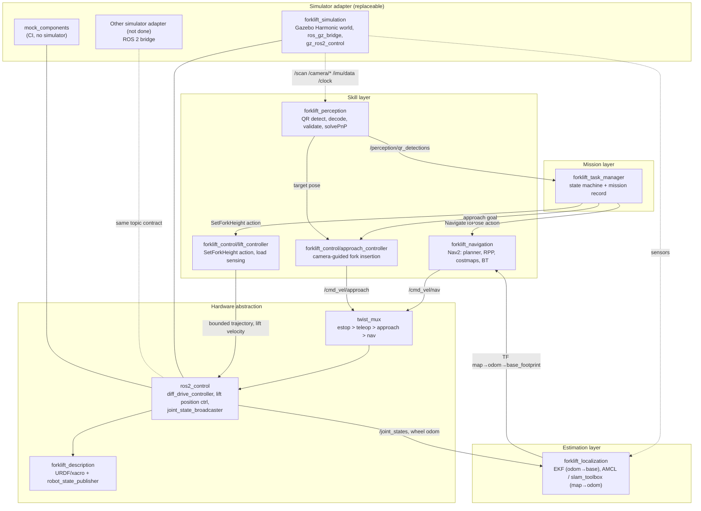

# Architecture

> Status: All the packages in the table below are complete and have tests. For the
> implementation plan, refer to [system_design.md](system_design.md).

## Layers

The system has layers. **All the layers above the adapter line are independent of the
simulator.** To use a different simulator, replace only the bottom layer and the ros2_control
hardware plugin.

## Packages

| Package | Function | Specific to the simulator? |
|---|---|---|
| `forklift_interfaces` | Messages, services and actions (`QrDetection`, `ForkState`, `MissionStatus`, `SetForkHeight`, `RunMission`) | No |
| `forklift_description` | Parametric xacro, sensor frames, `<ros2_control>` block with a selectable backend | Only the `sim_backend` include |
| `forklift_simulation` | Gazebo world, robot plugins, sensor models, bridge YAML, spawn launch, QR load models | **Yes** (this is the Gazebo adapter) |
| `forklift_control` | Controller YAML, twist_mux, rear-LiDAR reverse safety, lift action server, load sensing, `load_handler` pickup and place skills | No |
| `forklift_localization` | EKF configuration. The SLAM and AMCL configurations are in `forklift_navigation`. | No |
| `forklift_navigation` | Nav2 parameters, SLAM and AMCL configuration, saved map, footprint manager, scan self-filter | No |
| `forklift_perception` | QR detection, decoding, PnP pose, `qr_detector` node. The asset generator uses its QR encoder. | No |
| `forklift_task_manager` | Pure-Python state machine, ROS node, mission configuration (the single source of truth) | No |
| `forklift_fleet` | Multi-forklift coordinator: task registry, cost-based allocation, reservations, conflict resolution. One `fleet_agent` heartbeat for each robot. | No |
| `forklift_bringup` | `robot.launch.py` (one forklift, any namespace), `sim.launch.py` (one forklift), `multi_sim.launch.py` (two forklifts and the coordinator), `mock.launch.py` (no simulator) | It selects the adapter |
| `forklift_test` | Mock-hardware tests and Gazebo tests (sensors, TF, motion, lift, perception, navigation, pickup and place, mission, fleet) | Tier-3 tests need Gazebo |

## Interfaces between the layers

| Topic / action | Type | Publisher | Subscriber |
|---|---|---|---|
| `/clock` | `rosgraph_msgs/Clock` | simulator adapter | all (`use_sim_time`) |
| `/scan` | `sensor_msgs/LaserScan` | adapter | SLAM/AMCL, costmaps, collision monitor |
| `/camera/image_raw`, `/camera/camera_info` | `sensor_msgs/Image`, `CameraInfo` | adapter | perception |
| `/imu/data` | `sensor_msgs/Imu` | adapter | EKF |
| `/joint_states` | `sensor_msgs/JointState` | joint_state_broadcaster | robot_state_publisher, lift controller |
| `/forklift_base_controller/odom` | `nav_msgs/Odometry` | diff_drive_controller | EKF |
| `/odometry/filtered` | `nav_msgs/Odometry` | EKF | Nav2, task manager |
| `/cmd_vel/{nav,approach,teleop}` | `geometry_msgs/TwistStamped` | Nav2 / approach / teleop | twist_mux |
| `/forklift_base_controller/cmd_vel` | `geometry_msgs/TwistStamped` | twist_mux | diff_drive_controller |
| `/perception/qr_detections` | `forklift_interfaces/QrDetectionArray` | perception | task manager, approach controller |
| `/fork/state` | `forklift_interfaces/ForkState` | lift controller | task manager |
| `/fork/set_height` | `forklift_interfaces/action/SetForkHeight` | lift controller | task manager |
| `/mission/status` | `forklift_interfaces/MissionStatus` | task manager | operator, tests |
| `/mission/run` | `forklift_interfaces/action/RunMission` | task manager | operator |
| `/mission/{pause,resume,reset}` | `std_srvs/Trigger` | task manager | operator |
| `/navigate_to_pose` | `nav2_msgs/action/NavigateToPose` | Nav2 | task manager |
| `/ground_truth/odom` | `nav_msgs/Odometry` | Gazebo adapter | **only the evaluation tests** |

For the verified topic table with QoS and rates, refer to [sensor_setup.md](sensor_setup.md).

## Main rules
1. **Use perception, not ground truth.** The box identity comes only from the decoded camera
   pixels. Only the evaluation tests use ground truth.
2. **Each result must have evidence.** The lift effort and the perception data show that a
   pickup or a placement is correct. A sent command is not evidence.
3. **Each TF edge has one publisher.** Refer to [coordinate_frames.md](coordinate_frames.md).
4. **The mission comes from data.** One validated YAML file contains the boxes, the pickup
   poses and the destinations.
5. **Tests operate without a simulator when possible** (`sim_backend:=mock`). If a test needs
   a simulator and the simulator is not available, the report shows the test as skipped.
