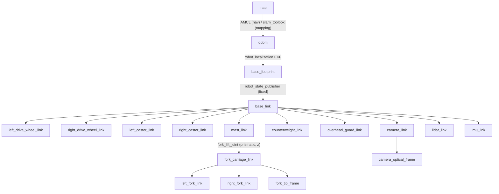

# Coordinate Frames and TF

All the frames obey REP-103 (x forward, y left, z up; SI units) and REP-105 (map, odom, base).
The camera optical frames use the optical convention (z forward, x right, y down).

> Status: `forklift_description` has these frames. The offsets below are for the default
> `forklift_params.yaml`. Automated tests check them.

## Tree

## Frame table

| Frame | Parent | Publisher | Type | Meaning |
|---|---|---|---|---|
| `map` | — | — | fixed to the world | Origin of the saved occupancy map |
| `odom` | `map` | AMCL **or** slam_toolbox | dynamic | Continuous odometry frame. It drifts. |
| `base_footprint` | `odom` | `ekf_filter_node` | dynamic | Projection of the drive-axle center on the ground. This is the rotation center of the differential drive and the Nav2 `robot_base_frame`. |
| `base_link` | `base_footprint` | robot_state_publisher | fixed | Drive-axle center at the height of the wheel axis |
| `*_drive_wheel_link` | `base_link` | robot_state_publisher | continuous joint | Driven wheels (encoder source) |
| `*_caster_link` | `base_link` | robot_state_publisher | fixed | Rear support wheels (spheres with no friction in the simulation) |
| `counterweight_link`, `overhead_guard_link` | `base_link` | robot_state_publisher | fixed | Structural bodies (mass and collision) |
| `mast_link` | `base_link` | robot_state_publisher | fixed | Mast uprights at the front of the chassis |
| `fork_carriage_link` | `mast_link` | robot_state_publisher | prismatic (z) | Carriage. The joint position is the fork height. |
| `left/right_fork_link` | `fork_carriage_link` | robot_state_publisher | fixed | Fork tines |
| `fork_tip_frame` | `fork_carriage_link` | robot_state_publisher | fixed | Point between the fork tips, on the top surface of the forks. This is the **alignment reference** for the pickup. |
| `camera_link` | `base_link` | robot_state_publisher | fixed | Camera body (x forward), below the front edge of the overhead guard, 40° down |
| `camera_optical_frame` | `camera_link` | robot_state_publisher | fixed | rpy = (−π/2, 0, −π/2). This is the `frame_id` of the image and of camera_info. |
| `lidar_link` | `base_link` | robot_state_publisher | fixed | `frame_id` of `/scan` |
| `imu_link` | `base_link` | robot_state_publisher | fixed | `frame_id` of `/imu/data` |

## Default frame poses in `base_footprint` (forks down, *q* = 0)

| Frame | xyz [m] | rpy [rad] |
|---|---|---|
| `base_link` | (0.000, 0.000, 0.180) | (0, 0, 0) |
| `left_drive_wheel_link` | (0.000, +0.400, 0.180) | (0, 0, 0) |
| `left_caster_link` | (−1.000, +0.250, 0.100) | (0, 0, 0) |
| `mast_link` | (0.260, 0.000, 0.000) | (0, 0, 0) |
| `fork_carriage_link` | (0.380, 0.000, 0.050 + *q*) | (0, 0, 0) |
| `fork_tip_frame` | (1.380, 0.000, 0.050 + *q*) | (0, 0, 0) |
| `lidar_link` | (0.250, 0.000, 0.120) | (0, 0, 0) |
| `camera_link` | (0.140, 0.000, 2.000) | (0, 0.700, 0) |
| `camera_optical_frame` | (0.140, 0.000, 2.000) | camera_link ∘ (−π/2, 0, −π/2) |
| `imu_link` | (−0.450, 0.000, 0.300) | (0, 0, 0) |

The links on the right side are a mirror of the links on the left side (y → −y).

## Transform authority (one publisher for each edge)

| Edge | Mapping mode | Navigation mode | Must NOT publish it |
|---|---|---|---|
| `map → odom` | slam_toolbox | AMCL | the other localizer; Gazebo |
| `odom → base_footprint` | EKF | EKF | `diff_drive_controller` (`enable_odom_tf: false`), Gazebo |
| robot-internal | robot_state_publisher | robot_state_publisher | Gazebo pose bridge |

The bridge sends the Gazebo ground truth as `nav_msgs/Odometry` on `/ground_truth/odom`. Its
frame IDs are `world` and `ground_truth_base`. These frames are **not** in the TF tree. Only
the tests use this topic.

## Multiple robots
When there are two or more forklifts, each robot frame starts with the namespace of the robot
(`forklift_1/odom`, `forklift_1/base_footprint`, `forklift_1/rear_lidar_link`, ...). All the
robots use the same `map` frame.

* robot_state_publisher gets `frame_prefix`.
* The Gazebo sensors get `gz_frame_id` values with the prefix.
* AMCL, the EKF, Nav2, the diff-drive controller and the forklift nodes (`frame_prefix`
  parameter) use the names with the prefix. The diff-drive controller does not add its own
  namespace prefix.

All the robots use one `/tf` tree with the root `map`. Each edge of each robot has one
publisher. A single robot uses the names above, with no prefix. For more data, refer to
[multi_robot_coordination.md](multi_robot_coordination.md).

## Validation
`forklift_description/test/test_mock_control_interfaces.py` makes sure that all the frames are
in the live robot_state_publisher TF. `test_urdf_model.py` checks the offsets and the
conventions.

`forklift_test/test/test_sim_sensors_tf.py` (Gazebo in operation) checks these items:
* All the frames above are present, and the tree is connected (`tf2_tools view_frames` and
  `lookup_transform`).
* No edge has two publishers. Only robot_state_publisher sends `/tf_static`. Each
  `odom → base_footprint` transform has an EKF output stamp. `diff_drive_controller` has
  `enable_odom_tf: false`. Its `/tf` publisher is present but does not send data, and the test
  checks this.
* The sensor `frame_id` values agree with the URDF frames.
* The sensor stamps are in one period of `/clock`. All the nodes use sim time
  (`use_sim_time: true`).

`forklift_test/test/test_sim_navigation.py` checks that, in navigation mode, only AMCL
publishes `map → odom` (slam_toolbox does not operate). AMCL stays in 10 cm and 1.4° of the
ground truth during a full tour of the staging poses. The origin of the saved map agrees with
the world frame. `forklift_navigation/test/test_navigation_config.py` checks the known
structures in 10 cm.
