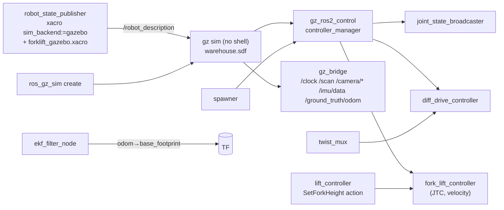

# Gazebo Simulation Setup

Status: **operational**. The setup uses Gazebo Sim 8.15 (Harmonic) through the ROS Jazzy
vendor packages, DART physics at 1 kHz, and headless EGL rendering on the NVIDIA GPU.

## Operation

```bash
cd ros2_ws && source scripts/env.sh && source install/setup.bash
ros2 launch forklift_bringup sim.launch.py                       # headless (default)
ros2 launch forklift_bringup sim.launch.py gui:=true rviz:=true  # with the Gazebo GUI and RViz
ros2 launch forklift_bringup sim.launch.py x:=-6.0 y:=-2.0 yaw:=0.0   # spawn pose
scripts/stop_sim.sh                                               # stop all
```

In headless mode, Gazebo continues to render the camera and the GPU LiDAR
(`--headless-rendering`, EGL). Thus you do not need a display. This is necessary for CI and
for remote computers.

## Nodes that `sim.launch.py` starts
* `sim.launch.py` starts the world and one `robot.launch.py` instance in the root namespace.
* `multi_sim.launch.py` starts the world, one instance for each robot, and the fleet
  coordinator.
* The bridge sends the clock one time for each world.
* The command chain of each robot is twist_mux → rear_safety → diff_drive_controller.



The startup sequence does not use fixed delays. It waits until each part is ready. The spawner
waits until the controller manager in Gazebo is available. The lift server refuses goals until
it receives `/robot_description` and new joint states.

## Controllers

| Controller | Type | Command interface |
|---|---|---|
| `joint_state_broadcaster` | `joint_state_broadcaster/JointStateBroadcaster` | — |
| `forklift_base_controller` | `diff_drive_controller/DiffDriveController` | wheel velocity |
| `fork_lift_controller` | `joint_trajectory_controller/JointTrajectoryController` | lift **velocity** (P = 2 and velocity feed-forward) |

Use only the action server to control the lift:
```bash
ros2 action send_goal /fork/set_height forklift_interfaces/action/SetForkHeight "{height: 0.5}"
ros2 topic pub -r 10 /cmd_vel/teleop geometry_msgs/msg/TwistStamped "{twist: {linear: {x: 0.3}}}"
ros2 topic pub --once /estop std_msgs/msg/Bool "{data: true}"     # stop; send false to release
```

## Verified behavior (automated tests in `forklift_test`)

| Check | Result |
|---|---|
| Spawn, and all three controllers are active | ✅ |
| Move for 4 s at 0.5 m/s, then stop | 1.93 m of travel, odometry in 5 cm, stop (< 0.01 m/s) |
| Dead-man: the commands stop, and the robot brakes | ✅ (twist_mux timeout 0.5 s and controller timeout 0.5 s) |
| Turn in position to the left and to the right | more than 60° in each direction, odometry in 2°, translation < 5 cm |
| The e-stop lock stops the motion, and the release starts it again | ✅ |
| Lift to 0.6 / 1.0 / 0.25 / 0.0 m | each in 1 cm (usually 1 mm) |
| Lift goals out of range (1.2 m, −0.05 m) | refused, the forks do not move |
| The lift holds 0.3 m during travel | ✅ |
| Sensors: rates, frames, stamps, values; TF | refer to [sensor_setup.md](sensor_setup.md) |

## Physics and model notes
* **Wheel contact:** the drive wheels have sphere collisions. With cylinder collisions, the
  contact points were at the edge of the rim, and this caused a 13% yaw-odometry error. Refer
  to [sensor_setup.md](sensor_setup.md).
* **Casters:** spheres with almost no friction (μ = 0.01).
* **Lift actuation:** velocity interface. Position commands through gz_ros2_control did not
  operate correctly. The plugin changes the position error into a velocity request
  (gain × error × rate). When this request was more than the 0.2 m/s joint limit, DART
  **froze the joint. It did not limit the velocity.** Measured results: gain 0.01 (request
  0.15 m/s) moved the joint, and gain 0.1 (1.5 m/s) froze it. Now the lift node sends
  trapezoidal profiles in the limit.
* **Load sensing:** with no load on the forks, the lift effort is 1079.1 N = (60 + 2×25) kg × g.
  The load handler uses an increase of this value to find a supported load.

* **The lift stays stuck after it touches its lower limit.** If the robot moves while the lift
  joint is at its lower limit (0.000 m), the joint stays at that limit. All the subsequent lift
  commands time out, although the velocity command points away from the limit. This occurred
  in 2 of 2 tests. With the lift at 0.02 m, it occurred in 0 of 2 tests. The cause is
  possibly how Gazebo solves the joint-limit constraint with a velocity command. Thus the load
  handler does not park the forks on the hard stop. It uses the insertion height (0.02 m). The
  first full mission run found this problem: the BOX_B pickup stopped with LIFT_FAILED.

* **The lift is locked at its lower limit from the spawn.** After the rear-LiDAR link was
  added, the lift joint stayed at 0.000 m and did not obey any command. This occurred in 4 of
  4 tests. With the previous model, the lift operated in 4 of 4 tests. Bisection showed that
  the removal of the link solves the problem. The removal of only its sensor, its collision or
  its yaw does not solve it. A move of the link to the end of the URDF also does not solve it.
  The DART mechanism is not known. It is possibly related to the problem above. Solution: the
  lift joint now *starts* at 0.02 m (`lift.initial_height`, the ros2_control position
  `initial_value`), not on its hard stop. After this change, 2 of 2 tests operated
  correctly. As an added safety step, the lift controller also lifts the forks off the stop one
  time at startup.

## Troubleshooting

| Symptom | Cause | Solution |
|---|---|---|
| "Controller already loaded", "Detected jump back in time", the robot does not obey commands | A second simulation is on the same ROS domain or Gazebo partition (a previous run did not stop) | Run `scripts/stop_sim.sh`. Use a different `ROS_DOMAIN_ID` and `GZ_PARTITION` for each simulation. |
| `gz sim` continues to operate after Ctrl-C | `gz_sim.launch.py` in ros_gz_sim starts Gazebo through `sh -c` | Solved: `forklift_simulation` starts `gz sim` without a shell |
| The camera data arrives at approximately 1–5 Hz | Best-effort subscription to 2.7 MB images | Use a RELIABLE subscription with depth 1–2 |
| The lift action stops with "joint_states stale" | A blocking callback stopped the executor | Solved: the lift server does not block (timer and awaited future) |
| `libEGL warning: egl: failed to create dri2 screen` | Mesa EGL examines the NVIDIA device, and then Gazebo uses the NVIDIA EGL | No effect. Gazebo shows as a GPU client in `nvidia-smi`. |
| Warning `XML Element[gz_frame_id] ... not defined in SDF` | sdformat does not know the Harmonic sensor extension | No effect. The tests verify the frame IDs. |
| All the boxes show the same QR code | Gazebo keeps textures in a cache by file name | Use a unique texture name for each model. The generator does this, and `test_load_models.py` checks it. |
| The box labels are dark or difficult to decode | The faces point away from the sun | Point lights on the ceiling above the aisles in `warehouse.sdf` |
| `missing Gazebo model` or `carries QR payload ...` at launch | The load models do not agree with the mission | Run `python3 src/forklift_simulation/scripts/generate_load_models.py` |
| `gazebo` stops with −9 after a long test | Sometimes the Gazebo server stops in its own shutdown and ignores SIGINT and SIGTERM (1 of 3 navigation-test runs; no output, no orphan process) | The launch file then sends SIGKILL. The tests accept −9 **only** for the Gazebo process and show a warning. The ROS nodes must stop correctly. |
| The package.xml lint takes minutes | IPv6 connection to download.ros.org times out | Run `source scripts/env.sh` (offline schema catalog) |

## Decrease the load on a laptop
* Keep `gui:=false` (default). Start RViz only when necessary.
* Decrease `sensors.camera.width/height/update_rate` in `forklift_params.yaml`. The camera
  uses the most resources. For example, 640×480 at 5 Hz is sufficient for motion tests. If you
  make this change, measure the QR decode range again.
* On the test computer (RTX 5060 laptop), physics operates at 1 kHz with RTF 1.0. If the RTF
  decreases, increase `max_step_size` to 0.002 in `warehouse.sdf` and do the motion tests
  again.
