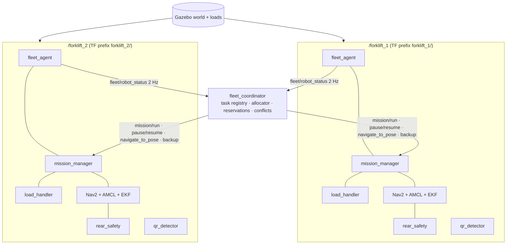

# Multi-Forklift Coordination and Rear LiDAR

Two autonomous forklifts operate in one warehouse and do the same three-box mission. A central
**fleet coordinator** gives the tasks to the robots and solves the conflicts. Each robot fully
controls its own navigation, perception and lift. Each forklift (also a single forklift) has a
**rear LiDAR** that guards all reverse motion.

```bash
source scripts/env.sh && source install/setup.bash
# one forklift (front + rear LiDAR):
ros2 launch forklift_bringup sim.launch.py start_mission:=true
# two forklifts + coordinator; start the fleet mission immediately, or send a goal:
ros2 launch forklift_bringup multi_sim.launch.py start_mission:=true
ros2 launch forklift_bringup multi_sim.launch.py rviz:=true
ros2 action send_goal --feedback /fleet/run forklift_interfaces/action/RunMission "{}"
ros2 topic echo /fleet/status          # tasks, owners, robots, reservations
ros2 topic echo /fleet/conflicts       # each conflict and its solution
ros2 service call /fleet/claim_task forklift_interfaces/srv/ClaimTask "{robot_id: forklift_1, box_id: BOX_B}"
```

## Architecture



There is no separate copy of the code for each robot. `forklift_bringup/launch/robot.launch.py`
starts one full forklift. `sim.launch.py` uses it in the root namespace. `multi_sim.launch.py`
uses it one time for each robot in `forklift_fleet/config/fleet.yaml`. For a robot with a
namespace, the launch file writes a temporary copy of each parameter file:
* the parameters go under the namespace;
* the robot frame names get the prefix (`odom` → `forklift_1/odom`);
* absolute topics become relative.

The xacro uses `robot_name`, `frame_prefix` and `ros_namespace`. Thus each robot has its own
Gazebo sensor frame IDs, Gazebo topics and ros2_control controller manager. All the node code
uses relative topic names and a `frame_prefix` parameter. The default values are the
single-robot values.

**To add a third forklift:** add its ID and home pose to `fleet.yaml`. `multi_sim.launch.py`
then starts one more `robot.launch.py`. The allocator, the registry and the conflict checks
are written for N robots. The allocation examines all the possible plans, so its cost
increases as robots^tasks. This is satisfactory for small fleets. No other change is
necessary. This is not tested with three robots.

### Namespaces and TF

| Item | one robot | forklift_N |
|---|---|---|
| topics | `/scan`, `/scan_rear`, `/camera/...`, `/odometry/filtered`, ... | `/forklift_N/<same>` |
| TF frames | `odom`, `base_footprint`, `rear_lidar_link`, ... | `forklift_N/odom`, `forklift_N/base_footprint`, ... |
| map frame | `map` | `map` (shared) |
| Gazebo entity / topics | `forklift`, `/forklift/...` | `forklift_N`, `/forklift_N/...` |
| controller manager | `/controller_manager` | `/forklift_N/controller_manager` |

There is one `/tf` tree: `map → forklift_1/odom → forklift_1/base_footprint → ...` and the
same for forklift_2. Each robot has one publisher for each transform: its AMCL (map→odom), its
EKF (odom→base) and its robot_state_publisher (the other transforms, with `frame_prefix`).
Each robot has its own map_server with the same saved map (shared map, no shared mutable
state), and its own AMCL, EKF, Nav2, costmaps and perception. The namespace prefix of the
diff-drive controller is off, because the frames already have the prefix.

## Rear LiDAR

| | Front `/scan` | Rear `/scan_rear` |
|---|---|---|
| mount (base_footprint) | x 0.25, z 0.12, points to +x | x −1.19, z 0.12, points to −x (yaw π) |
| field of view | ±95°, 381 rays (0.5°) | ±90°, 181 rays (1°) |
| range / rate | 0.1–12 m, 10 Hz | 0.1–8 m, 10 Hz |
| frame | `lidar_link` | `rear_lidar_link` |

The shared description (`forklift_params.yaml`, `forklift_body.xacro`) defines the rear LiDAR
one time. Thus all the configurations have it. It uses the same Gazebo `gpu_lidar` macro as the
front LiDAR. A unit test makes sure that no ray of the rear scan touches the robot body. The
two Nav2 costmaps also use the rear scan as an observation source.

**Reverse safety (`forklift_control/rear_safety.py`)** is between twist_mux and the drive
controller. Thus it guards all the sources of reverse motion: Nav2 (also the BackUp
recoveries), the back-out, retract and alignment back-off of the load skills, and teleop.

| Zone (behind the face of the LiDAR housing at x = −1.23 m, corridor ±0.64 m) | Reverse command |
|---|---|
| ≤ 0.35 m (stop) | blocked → STOP, the reason is published |
| nearer than the stopping distance d(v) = 0.35 + 0.3·v + v²/(2·0.5) | limited to the highest safe speed → SLOW |
| < 1.2 m (warning) | limited to 0.10 m/s → WARN |
| clear | no change |

To leave STOP, the robot needs 0.10 m of added clearance (hysteresis). An obstacle in the rear
swing radius (1.35 m + 0.10) blocks a turn in position. If there is no new rear scan, the state
is FAULT, and reverse motion and turns are blocked (fail-safe). This node does not limit
forward motion. The Nav2 collision monitor guards the front. The status goes to
`safety/rear_status`.

The load handler thinks that a rear STOP during reverse motion is a *wait*, not a stall. It
stops, reports `rear_blocked`, and fails with `REAR_BLOCKED` only after 90 s. It does not
continue only because the time is nearly at its end. The coordinator sees the rear state in
each heartbeat. It thinks that "robot Y blocks robot X at the rear" is a conflict (refer to the
text below).

## Task allocation (`allocator.py`)

Inputs:
* the AMCL pose of each robot;
* its availability (heartbeat, localized, not FAULT);
* if it is busy, and where its current task ends;
* its recent failures;
* the tasks that have no robot (pickup and destination staging poses);
* the current reservations.

The allocator does not use ground truth.

The allocator examines each assignment of the free tasks to the robots, in each order (3 tasks
× 2 robots: 24 plans). The cost of each robot is the sum of these values for each of its tasks:

    route(start → pickup) + route(pickup → destination)
    + switch_penalty (3 m)       if the task is currently planned for a different robot
    + congestion_penalty (4 m)   if the other robot works at, or goes to, a place in 3.5 m
    + recovery_penalty (5 m)     × the number of failures of the robot

The start of a robot is its current position. If the robot is busy, its start is the drop-off
of its current task, and the remaining distance is added. The plan with the smallest
**makespan** (the busiest robot) wins. If two plans are equal, the plan with the smallest total
wins. The coordinator sends only the first task of each idle robot. The other tasks stay
RESERVED. The allocator makes a new plan each time that a robot becomes free. Thus one robot can
get many sequential tasks. The switch penalty gives hysteresis against small cost changes.

Route length: the straight line × 1.3 (detour factor). A request to the Nav2 planner of each
robot would publish on its `plan` topic, and the conflict detector reads that topic. This is a
known limitation.

## Protocol

| Message | Direction | Mechanism | Notes |
|---|---|---|---|
| heartbeat / status | robot → coordinator | `/<id>/fleet/robot_status` (RobotStatus) 2 Hz | state, AMCL pose, speed, carrying, rear state, Nav2 path in front |
| task offer | coordinator → robot | `/<id>/mission/run` RunMission{box_ids:[box], skip_return_home} | unique assignment ID for each offer |
| accept / reject | robot → coordinator | action goal accepted / rejected | no answer in 8 s → retry (2×), then the robot is benched for 30 s, and the task is released |
| progress, completion | robot → coordinator | RunMission feedback / result + status lists | delivered only after the placement verification of the robot |
| failure | robot → coordinator | RunMission result, MISSION_FAILED | released if no load was lifted, HELD if not |
| yield / resume | coordinator → robot | `/<id>/mission/pause`, `/<id>/mission/resume` | the pause waits during pickup and placement |
| move away / back off | coordinator → robot | `/<id>/navigate_to_pose`, `/<id>/backup` | guarded by the rear LiDAR |
| conflicts | coordinator → all | `/fleet/conflicts` (ConflictEvent) | type, robots, tasks, resource, solution, wait, success |
| shared state | coordinator → all | `/fleet/status` (FleetStatus, latched) | tasks, robots, reservations |
| claims | any node → coordinator | `/fleet/claim_task` (ClaimTask) | authoritative; one grant for each box |

If the heartbeat of a robot stops for 5 s, the robot is not available:
* if the pickup did not start, the coordinator releases its task;
* if the pickup started or the box can be on the forks, the task is **HELD**. The coordinator
  does not give it automatically to a different robot.

When a robot comes back, the coordinator cancels its old mission goal before it gives it new
work.

## Task lifecycle and ownership (`registry.py`)

`AVAILABLE → RESERVED → ASSIGNED → PICKUP_IN_PROGRESS → PICKED_UP → DELIVERY_IN_PROGRESS → DELIVERED`,
and also `FAILED` (no more attempts) and `HELD` (load state not known; only an operator release
moves it back to AVAILABLE).

The registry validates each transition:
* only the owner reports progress;
* a robot owns a maximum of one task;
* only the robot that has the plan for a RESERVED task can claim it;
* a task cannot go back from DELIVERED.

PICKED_UP comes only from the lift load sensing of the robot. DELIVERED comes only from its
placement verification (lift release + camera), not from a navigation result. The operational
states of the robot, from the fleet agent, are: `IDLE`, `TASK_ASSIGNED`,
`NAVIGATING_TO_PICKUP`, `PICKING`, `NAVIGATING_TO_DESTINATION`, `PLACING`, `RETURNING`,
`PAUSED`, `FAULT`.

## Conflicts (`conflicts.py`, `coordinator_node.py`)

| Conflict | Detection (only robot estimates) | Solution |
|---|---|---|
| duplicate claim | registry | the first valid claim wins; the coordinator refuses the other claim (TASK_CLAIM event) |
| zone (pickup, shelf, home) | a robot goes to a place with a reserved zone, or a different robot is in the zone | the robot waits outside the zone until it gets the zone; the coordinator sends an idle occupant to home; to stop a cyclic wait, the occupant goes out first |
| path / head-on / intersection | the two robots navigate, and the Nav2 path of one robot (next 5 m) comes in 2.2 m of the other robot or its path | priority rules → the robot that gives way pauses; it continues when the path of the priority robot does not touch its position or its route, and the robots are more than 3 m apart |
| blocked path (stationary robot) | (not a coordination conflict) | Nav2 sees the robot with the front or rear LiDAR and makes a new path around it |
| reverse motion into a different robot | the rear state of the robot is STOP during a manoeuvre, and the other robot is behind it | the robot behind gives way; after 8 s the coordinator sends it to its wait location (home); the robot in reverse continues when its rear is clear |
| deadlock | the robot that gives way waited more than 40 s, and the priority robot moved less than 0.3 m in 15 s | 1) the robot that gives way moves back 1 m (only if its rear LiDAR is clear); 2) the right of way changes one time; 3) ESCALATED (reported, no blind manoeuvre) |

Priority rules (deterministic, decided one time for each conflict, so that the robots do not
give way to each other in turn):
1. The robot in the zone that the other robot goes to. It must go out so that the other robot
   can come in. This rule was added after a livelock in a Gazebo head-on test: the robot that
   gave way waited in the home zone of the priority robot, the zone conflict released it, and
   the next path conflict stopped it again.
2. The robot with a load, from the task lifecycle (PICKED_UP / DELIVERY_IN_PROGRESS). The
   effort-based load sensing of the lift is not used here, because it changed to true on an
   empty robot during that head-on test.
3. The robot that is already in its reserved zone.
4. The robot that moves.
5. The lower robot ID.

**The forks of the other robots in the costmaps.** The fork tines are below the two LiDAR scan
planes. Thus a robot sees a different robot only by its chassis, 1.4 m behind the fork tips of
that robot. In the same head-on test, the robots met fork tip to fork tip. Now each fleet agent
publishes `fleet/peer_obstacles` (PointCloud2, map frame, 5 Hz). It contains points in the
outline of each *other* robot (body and tines, +0.10 m, longer to the front by speed × 0.5 s),
at the pose from the heartbeat of that robot. When the fleet agent operates, `robot.launch.py`
adds this topic to the obstacle layers of the two costmaps. Thus the costmaps inflate it like
all obstacles. It only marks obstacles: after the other robot moves, the LiDAR rays of the
robot clear the old points. The single-robot configuration has no change.

Each reservation has its owner, grant time, expiry (20 s, renewed each cycle while necessary)
and direction. Thus a robot that is not available can block a zone for a maximum of 20 s. Its
last known pose is still occupied.

## Results

All the values come from Gazebo runs. Only the test observers use ground truth. The last full
suite (2026-10-29, last code) passed 489/489 tests.

**One forklift: baseline (791608e, no rear LiDAR) and updated version.** Same mission, same
metrics observer (robot body against the map while Nav2 is active):

| | Baseline | Updated (rear LiDAR) |
|---|---|---|
| result | COMPLETE 3/3 | COMPLETE 3/3 |
| mission time | 581 s sim / 603 s wall | 578 s sim / 595 s wall |
| path length | 59.4 m | 59.7 m |
| Nav2 goals successful | 7/7 | 7/8 (one retry) |
| body–map overlap samples | 0 | 0 |
| rear-safety stops | n/a | 0 |
| placement error (A / B / C) | 5.5 / 3.4 / 5.4 cm | 4.1 / 5.5 / 4.2 cm |

Last-suite `test_sim_mission` (updated): 3/3, 3.8 / 4.5 / 4.1 cm, home in 2.5 cm.

**Rear LiDAR (`test_sim_rear_safety`, 5/5).** 10.0 Hz, 181 rays, frame `rear_lidar_link`. In
reverse toward an obstacle, the robot stopped after 0.57 m with a 0.43 m gap (STOP at 0.35 m).
Forward motion was still possible. The reverse motion continued after the removal of the
obstacle.

**Two forklifts (`test_sim_fleet`, last suite).** MISSION_COMPLETE 3/3 in 378 s sim (631 s
wall). forklift_1: BOX_A; forklift_2: BOX_C, then BOX_B. Each box had one owner at all times.
0 conflicts (the allocation kept the robots apart), 0 robot-overlap samples. Ground truth:
placements 4.7 / 5.3 / 5.2 cm, no load faster than 0.48 m/s (no teleport). The mission time is
32 % less than with one forklift (378 s against 578 s sim). A manual run gave 387 s,
1.9 / 6.6 / 2.2 cm.

**Conflicts (`test_sim_fleet_conflicts`, last suite).**
* Rear to rear: the two rear LiDARs stopped their robots (STOP). The gap between the rear faces
  was 0.34 m. The rear values were 0.32 / 0.33 m.
* Head-on on the center line of the hall: 3 HEAD_ON conflicts, each RESOLVED in 1 s (forklift_2
  gave way, forklift_1 went past). The two robots were at home in 43 s. 0 overlap samples (the
  outline includes the forks) during the positioning and the fleet run. Before the
  zone-clearing rule and the peer outlines, the same scenario had a livelock for more than
  10 min, and the robots possibly touched fork tip to fork tip.

**Fake-robot scenarios (`test_fleet_coordinator`, 7/7):** duplicate claim, robot loss with
release and with HELD, ack timeout and benching, zone wait, path yield and resume, deadlock
recovery, rear-blocked handling.

**Home parking accuracy (last suite, ground truth against the fleet home poses):**

| | true pose against home | estimate of the robot against truth |
|---|---|---|
| forklift_1 (−6, 0, 0°) | 3.0 cm / 2.4° | 10.3 cm / 7.7° |
| forklift_2 (5, 0, 180°) | 7.6 cm / 2.6° | 1.6 cm / 0.4° |

Nav2 parks the robot in 8 cm / 3.4° of home, by the *estimate* of the robot (goal tolerance).
The visible offset at home is this tolerance and the AMCL error. A yaw of 2.5° moves the fork
tips ≈ 6 cm to the side. The home area has few features (the scan does not constrain x well
there, refer to `lifecycle_starter.py`). After parking, the estimate of forklift_1 had an error
of 10 cm / 7.7°. Before, the coordinator ignored failed home goals in 0.6 m of home. Now it
tries them again (home_tolerance 0.25 m, 3 attempts).

**Failures during development (two robots), all with solutions:** LIFT_FAILED (lift locked on
its lower stop); the mission of a robot started automatically; DDS discovery misses (a robot
never available, QR topic missed, AMCL did not publish map→odom); INSERTION_BLOCKED (mast
margin approximately 1 cm); navigation retries against an old map→odom; head-on livelock and
fork contact.

## Limitations

* The route costs are straight-line estimates, not Nav2 plans.
* The path conflicts use the paths in front and the robot poses, with no time or speed
  profiles. In open areas this is conservative: sometimes it stops a robot that could go past
  safely.
* The zones are circles around places. There are no lane graphs or aisle graphs. The warehouse
  is one open hall, so aisle reservations were not necessary. The path-conflict rules control
  the head-on meetings in the hall.
* The robots do not see each other in their costmaps out of LiDAR range, and there is no
  shared obstacle layer.
* The recovery from HELD needs an operator. No automatic check of the load occurs.
* AMCL in an area with few features (up to 10 cm / 7.7° estimate error measured) and the
  8 cm / 3.4° goal tolerance limit the home parking accuracy. A smaller tolerance alone cannot
  solve this. A marker at the home positions can solve it.
* DDS discovery misses and rclpy "Unable to convert call argument" take errors occur at
  intervals in the two-robot graph of approximately 70 nodes (Fast DDS). The system decreases
  their effect (subscribe again, AMCL cycling, resilient spin loops), but the cause is not
  known. CycloneDDS crashed 16–17 times for each bringup, so it is not usable here.
* Tested only with two robots. Only fake robots tested the rear-blocked-by-robot coordination
  path.
* **The fork tines are below the LiDAR scan plane.** Lowered tines are at z 0.03–0.07 m, below
  the 0.12 m plane of the two scanners. Thus when a forklift comes *forks first*, the other
  robot sees its chassis face, 1.4 m behind its fork tips. Nav2 now gets the outlines of the
  other robots from their heartbeats (refer to the text above), but this needs communication
  and localization. The rear-safety filter uses only sensors. It would not stop a robot that
  reverses onto the forks of a different robot, or onto the forks of a vehicle that is not in
  the fleet. A real installation needs a rear sensor at a lower position or fork-tip detection.
