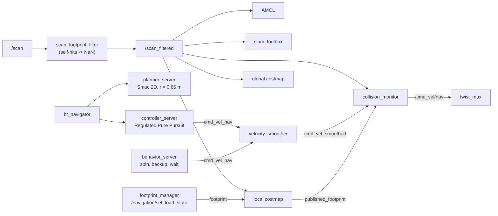

# Mapping, Localization and Navigation

Status: **complete and verified in Gazebo**. The system makes the map with slam_toolbox. It uses
AMCL on the saved map for localization. Nav2 moves the robot to all six staging poses, goes
around obstacles, does recovery behaviors and uses a footprint that changes with the load. All
these functions have automated tests (`test_sim_navigation.py`).

## Modes and transform authority

| `mode:=` | Started nodes | `map → odom` | `odom → base_footprint` |
|---|---|---|---|
| `mapping` | slam_toolbox (online async) (and Nav2 with `nav:=true`) | slam_toolbox | EKF |
| `navigation` (default) | map_server + AMCL + Nav2 | AMCL | EKF |
| `none` | no localizer | — | EKF |

The two modes also start `footprint_manager` and `scan_footprint_filter`. The design makes sure
that only one localizer operates at a time. The navigation test makes sure that AMCL publishes
TF and that slam_toolbox does not.



## 1. Mapping procedure (repeatable)
```bash
# terminal 1: the map must not contain loads that move
ros2 launch forklift_bringup sim.launch.py mode:=mapping spawn_loads:=false
# terminal 2: move along the fixed loop through the two aisles, save, align
scripts/build_map.py            # -> src/forklift_navigation/maps/warehouse.{pgm,yaml}
colcon build --packages-select forklift_navigation
```
`build_map.py` does these steps:
1. It moves the robot along a fixed route (south aisle, east end, north aisle, back) with EKF
   odometry.
2. It lets slam_toolbox close the loop.
3. It saves the map with `nav2_map_server map_saver_cli`.
4. It **aligns the map frame with the world and mission frame**. It moves the saved origin by
   the start pose of the mapping (home, (−6, 0, 0)). Thus the mission coordinates are valid
   navigation goals.

The run took 2 min 11 s. The result is 321 × 242 cells at 0.05 m. The map in the repository
passes the alignment checks: the walls, columns, platform fronts and rack front are all in
10 cm of their world positions.

**Why the map does not include the loads:** the loads move during the mission. If they were in
the map, the map would show obstacles at the pickups that are not there, and it would not show
the loads at the shelves. The obstacle layers find the loads during operation.

## 2. Localization (navigation mode)
AMCL uses the differential motion model, the likelihood-field laser model, 500–2000 particles
and `/scan_filtered`. The initial pose is the start pose that the operator knows (the spawn
pose, from `sim.launch.py`). This is the same as "2D Pose Estimate" in RViz. AMCL does not use
ground truth.

## 3. Nav2 configuration for this forklift
* **Kinematics:** differential drive that turns in position. Regulated Pure Pursuit with
  `use_rotate_to_heading` (first turn, then move), `allow_reversing: false` (the front LiDAR
  cannot see behind the robot), 0.4 m/s, collision check of the full footprint along the path.
* **Planner:** Smac 2D on a global costmap. This costmap shows the robot as a circle of
  r = 0.66 m (the widest part of the footprint and 5 cm). Thus the paths stay away from
  obstacles on the sides. The footprint checks of the controller and the turn clearance at the
  staging poses (verified offline against the map) cover the long axis.
* **Footprint (forks and load):** concave polygons in `config/footprints.yaml`. They cover the
  chassis, the drive-wheel collision spheres (±0.61 m locally), the mast and the 1.0 m forks. A
  test projects each URDF collision primitive and makes sure that it is 2 cm or more inside the
  polygon. The *loaded* polygon makes the fork section wider to cover a 0.8 m pallet.
  `footprint_manager` changes the footprint of the local costmap on `/navigation/set_load_state`
  (std_srvs/SetBool). The collision monitor and the scan filter use the same footprint.
* **LiDAR self-filter:** when the forks are down, the fork shanks give returns of 0.17–0.19 m
  at ±61°, in the footprint. Without the filter, the collision monitor would always see a
  collision, and SLAM/AMCL would add the robot to the map. `scan_footprint_filter` sets the
  returns in the current footprint (+5 cm) to NaN.
* **Safety chain:** velocity smoother (≤ 0.4 m/s, deceleration 0.5 m/s², the limit from the
  tip-over analysis), then collision monitor (footprint "approach", 1.2 s horizon), then
  twist_mux (the e-stop has a higher priority than Nav2).
* **The local costmap includes the static map.** Thus the recoveries that move to the rear
  (BackUp 0.30 m) know about the walls in the blind rear sector of the front LiDAR.
* **Recoveries:** the default Nav2 BT (clear costmaps, spin, wait, back up; 6 retries).
* **Lifecycle bringup:** `forklift_navigation/lifecycle_starter`, not `nav2_lifecycle_manager`.
  In one full-suite run, the AMCL reply to `configure` was lost
  (`failed to send response to /amcl/change_state (timeout)`, a Fast DDS startup race). The
  Jazzy lifecycle manager has no timeout and no retry. Thus localization did not become active.
  The starter reads the state of each node again after each request and tries again. A lost
  reply does not stop it. The starter does not use Nav2 bond monitoring. To restart nodes,
  start the launch again.

## 4. Staging poses
The mission configuration gives the staging poses (`MissionConfig.pickup_staging /
destination_staging`). At each pose, the robot points to the load or the platform, and the
fork tips are 0.8 m in front of the pallet front.

| Staging pose | x | y | yaw |
|---|---|---|---|
| BOX_A / BOX_B / BOX_C pickups | −3.0 / 0.0 / 3.0 | −2.02 | −90° |
| SHELF_01 / SHELF_02 / SHELF_03 | −3.0 / 0.0 / 3.0 | 2.72 | +90° |

## 5. Verified results (Gazebo, `test_sim_navigation.py`; last configuration, 3 runs)

| Check | Result |
|---|---|
| TF | `map → odom` (only AMCL), `odom → base_footprint` (EKF), robot tree; initial AMCL error < 10 cm |
| Staging tour (A pickup → SHELF_01 → B → SHELF_03 → C → SHELF_02) | 6/6 SUCCEEDED in each run (8 runs in total during development); 16–27 s for each leg |
| Last pose compared with ground truth | 2.1–13.7 cm, 0.0–4.9° in all runs (tolerance 15 cm / 5°; goal checker 8 cm / 3.4° and AMCL error) |
| Localization along the tour (~700–800 samples at 5 Hz, with turns, AMCL compared with ground truth at the same time) | median 3.0–3.6 cm, maximum 6.4–8.3 cm; yaw median 0.16–0.19°, maximum 0.94° |
| Collisions (true footprint against mapped obstacles, parked loads, test crate) | none |
| Loaded footprint | costmap fork section 0.28 → 0.43 m; navigation to home was successful; changed back |
| Dynamic obstacle (0.7 m crate on the path) | the LiDAR saw it, Nav2 made a new path around it, the robot got to the goal, no contact |
| Goal that the robot cannot reach (in a column) | ABORTED after 16 recovery attempts, no collision |

Offline tests (`forklift_navigation/test/test_navigation_config.py`, 34 tests): footprints
against the URDF and the pallet dimensions, self-filter geometry, stamped command chain, speed
limits, frames, map alignment, clear aisles, no loads in the map, and turn space at each
staging pose.

### Localization spikes: the cause was the EKF, not AMCL
Full-suite runs showed temporary localization errors of 16–19 cm at home during the first
turn. First I thought that AMCL caused them, because the scan geometry is weak there. I tuned
AMCL (alphas 0.02, 190 beams), and then gave it an accurate initial pose. **These changes did
not solve the problem.** Data from a failed run showed:

* ground truth: the robot moves away correctly (x −6.000 → −5.84);
* wheel odometry: correct (+0.16 m);
* **EKF:** the heading and the velocity were correct, but its *position* moved
  **0.3–0.5 m to the rear**. Its own velocity cannot cause this. Thus the error was in the
  filter. AMCL only followed it.

Controlled tests, first leg from home without loads:

| EKF configuration | Runs with a jump |
|---|---|
| original (smoothing on) | 4–6 of 10 |
| smoothing of lagged data off | 6 / 10 (not the cause) |
| no IMU fusion | 0 / 6 |
| IMU on, acceleration-state process noise ≈ 0 | **0 / 6** |

No sensor measures acceleration here. Thus it was incorrect to let the ax/ay/az states change
freely. The solution sets their process noise to ≈ 0. This solution keeps the fusion of the
gyro yaw rate, which corrected an 11° heading error from wheel slip. The AMCL tuning and the
accurate initial pose stay: they are correct, but they were not the solution. The lifecycle
starter publishes the initial pose with a 5 cm / 2° uncertainty.

### Recovery after a Nav2 server crash
In one full-suite run, the Nav2 `planner_server` had a segfault (exit code −11) during its
configure transition, in the Nav2 binary. This occurs in approximately 1 of 40 launches. There
was no core dump, so the cause is not known. The bringup stopped, and the test did not start.
Now:

* the six Nav2 servers operate with `respawn: true` (2 s delay);
* `lifecycle_starter` continues to monitor after the startup. If a node is in a state that is
  not ACTIVE (a respawned process starts UNCONFIGURED), the starter configures and activates it
  again.

Verification: a SIGSEGV was sent to `planner_server` one time during startup and two times
after activation. Each time, the server recovered, and the next NavigateToPose goal was
successful. No processes stayed after the shutdown. The localization nodes (map_server, AMCL)
do not respawn: a restarted AMCL does not know the robot pose. Thus that crash must stay
visible. The tests show a recovered Nav2 crash as a WARNING line.

## Limitations
* **The staging accuracy is approximately 10 cm** (goal tolerance and AMCL error). This is
  sufficient to see the QR code (perception range 2.25–4.25 m), but not to insert the forks.
  The camera-guided approach removes this error.
* **Rear blind area for Nav2:** Nav2 reverses only with the 0.30 m BackUp of the BT at
  0.15 m/s, and checks it only against the static map. The rear LiDAR and `rear_safety` guard
  this motion (refer to [multi_robot_coordination.md](multi_robot_coordination.md#rear-lidar)).
* **The planner circle is conservative:** the planner thinks that passages narrower than
  1.32 m are blocked, but the real chassis is 0.92 m wide. The warehouse aisles are
  approximately 4 m wide.
* **The loaded footprint must be set.** The task manager sets it. If it is not set, the width
  of the pallet has no protection.
* **AMCL needs a correct initial pose.** Global localization (kidnapped robot) is not
  configured.
* **Weak geometry at home:** at home, the robot looks along the hall, so the scan does not
  constrain x well. AMCL uses odometry there. An odometry fault (for example the EKF problem
  above) goes directly into the map pose.
* **The spin recovery needs approximately 1.5 m of turn space** around the drive axle. The
  aisles have this space. The collision checks of the behavior server guard the other areas.
* **Only Gazebo:** the map, the tuning and the times are simulation results.
