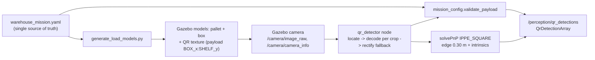

# Perception: QR Identification and Target Pose

Status: **complete and verified**, on synthetic images (unit and node tests) and on rendered
Gazebo camera images (simulation test). The system identifies the boxes **only** from the
camera pixels. The node does not read Gazebo entity names or ground truth.

## Data flow

## Mission configuration and QR payloads
`forklift_task_manager/config/warehouse_mission.yaml` defines the boxes, pickups,
destinations, home pose, load dimensions and printed QR size. `mission_config.py` validates
this file (IDs, references, uniqueness, dimensions, and the label size on the box). It is the
only code that decides if a payload is acceptable.

| Box | Pickup | Destination | Payload |
|---|---|---|---|
| BOX_A | PICK_01 (−3.0, −4.6) | SHELF_01 | `BOX_A:SHELF_01` |
| BOX_B | PICK_02 (0.0, −4.6) | SHELF_03 | `BOX_B:SHELF_03` |
| BOX_C | PICK_03 (3.0, −4.6) | SHELF_02 | `BOX_C:SHELF_02` |

The code makes the payload as `<id>:<destination>`. Nobody writes it manually, so it cannot be
different from the configuration. Validation results (`QrDetection.rejection_reason` starts
with the status):

| Status | Example | Meaning |
|---|---|---|
| `ok` | `BOX_B:SHELF_03` | Accepted |
| `empty` | — | The symbol is located, but it does not decode |
| `invalid_characters` | `hello world` | Non-ASCII, space or control characters |
| `malformed` | `PALLET-42` | Not `<ID>:<ID>` with IDs that agree with `^[A-Z][A-Z0-9_]{0,31}$` |
| `too_long` | — | Longer than `qr.max_payload_length` |
| `unknown_box` | `BOX_Z:SHELF_01` | The box is not in the mission |
| `unknown_destination` | `BOX_A:SHELF_09` | The destination is not in the mission |
| `destination_mismatch` | `BOX_B:SHELF_01` | The QR code does not agree with the configured assignment |

"Already delivered" is a check of the mission state. The task manager does this check.

## QR assets in Gazebo
`src/forklift_simulation/scripts/generate_load_models.py` writes one model for each box and for
each test decoy. Each model has:
* a pallet with three stringers and two 0.25 m fork pockets;
* a 0.6 m box;
* a texture with the real QR code (OpenCV encoder, error correction M, version 1 = 21×21
  modules).

The symbol is 0.30 m with a quiet zone of 4 modules (0.414 m label). It is at the center of the
box front, 0.40 m above the floor. `gazebo.launch.py` spawns the loads at their configured
pickup poses. It does not start if the payload in a model does not agree with the mission.
`test_load_models.py` compares the models in the repository with a new generation.

## Detection and decoding (`qr_detection.py`)
1. **Locate** all the symbols with `cv2.QRCodeDetector.detectMulti`.
2. **Decode each symbol on its own crop** (2× larger if the crop is less than 90 px). A decode
   is accepted only if its corners agree with the located symbol.
3. **Rectified fallback:** if the crop does not decode, warp the located quad to a square in
   front view and decode again. This solves the steep downward view at short range.
4. The node also reports symbols that it locates but cannot decode (payload `''`, status
   `empty`). Thus the task manager can know the difference between "QR unreadable" and "no
   box".

## Pose estimation (`pose_estimation.py`)
`cv2.solvePnPGeneric(..., SOLVEPNP_IPPE_SQUARE)` uses the 4 symbol corners (TL, TR, BR, BL),
the printed edge length (0.30 m) and the `camera_info` intrinsics. The function gives two
planar solutions. The node keeps the solution that is physically valid (in front of the camera,
face toward the camera) and has the lowest reprojection error. Output: the QR frame (x right,
y up, z out of the face) in `camera_optical_frame`. The subscribers change it with TF.
`confidence` uses the apparent size and the reprojection error.

**Assumptions:** the intrinsics are correct (exact in the simulation; a real camera needs
calibration), the label is flat and printed at exactly 0.30 m (the distance changes linearly
with this value, and a test checks this), and `camera_info.d` gives the distortion (zero in
Gazebo).

## Interface

| Topic | Type | Notes |
|---|---|---|
| `/camera/image_raw` (in) | `sensor_msgs/Image` | RELIABLE, depth 1 (refer to [sensor_setup.md](sensor_setup.md)) |
| `/camera/camera_info` (in) | `sensor_msgs/CameraInfo` | intrinsics for PnP |
| `/perception/qr_detections` (out) | `forklift_interfaces/QrDetectionArray` | One for each processed frame, **also empty frames**, with the image time stamp |
| `/perception/qr_debug` (out) | `sensor_msgs/Image` | Annotated image; rendered only when there is a subscriber |

The task manager gets the detections by subscription (the latest array shows what is visible
now). The parameters are in `forklift_perception/config/qr_detector.yaml`.

## Measured performance (Gazebo, robot moves straight to BOX_B)
The camera is 2.0 m high and 40° down; 1280×720, 70° HFOV.

| Distance to the QR code | View angle | Symbol size | Decoded | Distance error (median) |
|---|---|---|---|---|
| ≥ 4.75 m | ≤ 20° | < 64 px | 0% (not located) | — |
| 4.50 m | 21° | 64 px | 67% | 7 mm |
| 4.25 – 2.25 m | 22 – 46° | 67 – 104 px | **100%** | 9 – 17 mm |
| 2.00 m (fork tips 0.16 m in the pallet) | 54° | 111 px | 46% (goes out of the image) | 11 mm |
| 1.75 m | 60° | — | 0% (out of view) | — |

From view poses approximately 2.85 m from each box, the full pipeline (pose → TF → world,
compared with the configured box pose) gave these results in the last verification run:

| Box | Position error (median) | Face-yaw error (median) |
|---|---|---|
| BOX_A | 10 mm | 0.3° |
| BOX_B | 1 mm | 0.8° |
| BOX_C | 3 mm | 0.8° |

(`test_sim_perception.py`, tolerance 50 mm / 5°. Previous runs gave 7–13 mm and 0.1–1.1°.)
**Effect on load handling:** the code stays visible until the fork tips get to the pallet. The
last approximately 0.6 m of the fork insertion must use odometry from the last visual
measurement.

## Problems found in Gazebo, and solutions
1. **Incorrect payload on the incorrect symbol.** With two visible codes, OpenCV 4.6
   `detectAndDecodeMulti` gave the payload of one code for the two codes, and did not find the
   other. This is not safe: a payload goes with the incorrect pose. Solution: locate with
   `detectMulti` and decode each crop separately.
2. **All the labels showed the same code.** All the textures had the name `qr_label.png`. The
   Gazebo renderer kept the texture in a cache by file name, so the subsequent models showed
   the first texture. Solution: a unique texture name for each model. A test makes sure of
   this.
3. **Dark labels.** The sun did not light the faces that point to the aisles. Solution: ten
   point lights on the ceiling above the aisles (the white of the label went from approximately
   115 to 208 grey level).
4. **Steep views did not decode** at approximately 2.25 m. Solution: the rectified fallback
   (16/23 → 24/24 frames).

## Tests
* `forklift_task_manager/test/test_mission_config.py` (39): configuration validation, all
  payload results.
* `forklift_perception/test/test_qr_pipeline.py` (35): generation, decoding (one code, many
  codes, damaged, far), refusal of decoded payloads that are not valid, pose accuracy at
  1.2–3.0 m and ±25° yaw (≤ 1 cm + 1%, ≤ 3°), noise and blur, exact-projection check,
  quaternion conversion.
* `forklift_perception/test/test_qr_node_launch.py` (4, no simulator): the real node gets
  synthetic images through ROS.
* `forklift_simulation/test/test_load_models.py` (5): the models in the repository agree with
  the generator and the mission.
* `forklift_test/test/test_sim_perception.py` (4, Gazebo): decoys are refused; BOX_A/B/C are
  identified with a world-pose error of ≤ 5 cm and ≤ 5°.

## Limitations
* The camera resolution limits the decode range (≈4.25 m). A larger label, or a camera with a
  narrower view or a higher resolution, can increase it.
* The rendered labels are clean. The model does not include real dirt, glare or motion blur.
  It includes only Gaussian image noise (σ = 0.005), and the unit test includes noise and blur.
* One QR code on each load face. The node does not decode a code that is partly hidden. If it
  locates the code, it reports it as `empty`.
