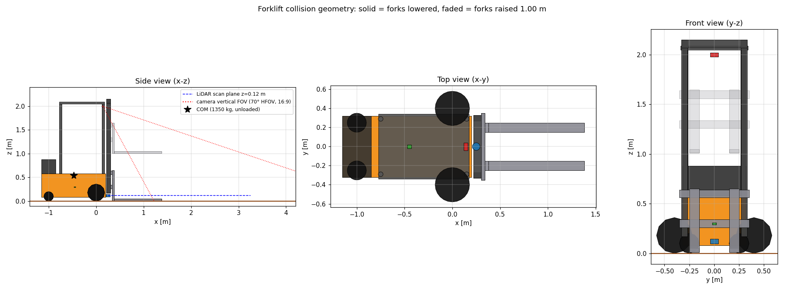

# Robot Model (`forklift_description`)

Status: **validated, and operational in Gazebo**. The static checks, `check_urdf`, the
URDF→SDF conversion and a live mock-hardware ros2_control test all pass.



*To make this image again, run `scripts/render_model_views.py` (with the workspace sourced).
The script draws the URDF collision geometry, and adds the LiDAR scan plane, the vertical FOV
of the camera and the center of mass.*

## Configuration
All the dimensions, masses and actuator limits are in
[`src/forklift_description/config/forklift_params.yaml`](../src/forklift_description/config/forklift_params.yaml).
To change the design, copy the file and give it to xacro. You do not need to change the xacro:

```bash
xacro src/forklift_description/urdf/forklift.urdf.xacro params_file:=/abs/path/my_params.yaml
```

| xacro argument | Default | Purpose |
|---|---|---|
| `params_file` | package `config/forklift_params.yaml` | YAML with dimensions and masses (absolute path) |
| `sim_backend` | `mock` | ros2_control plugin: `mock` (`mock_components/GenericSystem`) or `gazebo` (`gz_ros2_control/GazeboSimSystem`). Other values stop the generation. |
| `ros2_control` | `true` | Include the `<ros2_control>` block |
| `extensions` | empty | Absolute path to a xacro for a specified simulator (Gazebo sensors and plugins). This keeps this package independent of the simulator. |

## Kinematic layout
* **Drive:** differential. Two driven wheels (r = 0.18 m, track 0.80 m) on the front axle. The
  wheel *collision* is a sphere, and the visual is a cylinder. In DART, cylinder contacts were
  at the edge of the rim and caused a 13% yaw-odometry error
  ([sensor_setup.md](sensor_setup.md)). The wheels are directly below the mast.
  `base_footprint` and `base_link` are on this axle. Thus the robot turns in position around a
  point 1.38 m behind the fork tips (reason: D2 in [system_design.md](system_design.md)).
* **Support:** two rear spheres (r = 0.10 m) at x = −1.00 m (wheelbase 1.00 m) on fixed joints.
  In the simulation, they have almost no friction. Thus they operate as free casters with no
  swivel-joint jitter. *Approximation:* real casters have rolling resistance and swivel lag.
* **Lift:** `fork_lift_joint`, prismatic along z between `mast_link` and `fork_carriage_link`.
  Joint position *q* ∈ [0, 1.00] m. The height of the top surface of the forks above the floor
  is 0.05 + *q*. Velocity limit 0.20 m/s, effort limit 10 kN (≥1.5× the rated 500 kg and
  110 kg of carriage and forks), viscous damping 200 N·s/m.
* **Forks:** two L-shaped tines, 1.00 m long, 0.10 m wide, 0.04 m thick, 0.40 m apart (center
  to center), rigidly attached to the carriage. There is no side-shift and no tilt (mast tilt is
  not included).

| Joint | Type | Parent → child | Axis | Limits |
|---|---|---|---|---|
| `left/right_drive_wheel_joint` | continuous | `base_link` → wheel | +y | 6 rad/s, 400 N·m |
| `fork_lift_joint` | prismatic | `mast_link` → `fork_carriage_link` | +z | 0–1.00 m, 0.20 m/s, 10 kN |
| all other joints | fixed | refer to [coordinate_frames.md](coordinate_frames.md) | | |

## ros2_control interfaces
| Joint | Command | State |
|---|---|---|
| `left_drive_wheel_joint`, `right_drive_wheel_joint` | `velocity` (±6 rad/s) | `position`, `velocity` |
| `fork_lift_joint` | `velocity` (±0.20 m/s); position goals go through the `SetForkHeight` action | `position`, `velocity`, `effort` (load sensing) |

## Mass properties
| Link | Mass [kg] | Inertia model |
|---|---|---|
| `base_link` (chassis) | 600 | solid box 1.35×0.64×0.50 |
| `counterweight_link` | 400 | solid box 0.30×0.64×0.30 |
| `overhead_guard_link` | 40 | **approximation:** one solid box around the posts and the roof |
| drive wheels | 2 × 30 | solid cylinder |
| casters | 2 × 10 | solid sphere |
| `mast_link` | 120 | **approximation:** one solid box around the two uprights |
| `fork_carriage_link` | 60 | **approximation:** one solid box around the two bars |
| forks | 2 × 25 | tine box and shank box (parallel-axis theorem), mass divided by volume |
| sensors | 0.35 total | small boxes and cylinders |
| **Total** | **1350.3** | center of mass at x = −0.47, z = 0.54 m (no load, forks down) |

The masses are engineering estimates for a compact electric pallet stacker. They are not
datasheet values. The rated load is 500 kg. The mission boxes are much lighter (~30 kg).

**Stability checks** (automated): the center of mass stays in the support polygon with a margin
of 0.15 m or more, with no load and with 50 kg at all lift heights. With the full rated load of
500 kg at 1.0 m lift and 0.5 m/s² braking, the center of mass stays 0.03 m or more behind the
tip line of the front axle.

## Overall dimensions
Length 2.53 m (x ∈ [−1.15, 1.38], counterweight to fork tips), width 0.92 m (across the drive
wheels), height 2.15 m (mast top). The Nav2 footprint uses these dimensions.

## Validation
```bash
source scripts/env.sh && colcon build --symlink-install --packages-select forklift_description
source install/setup.bash

# 1. Generate the URDF, then check the syntax and the tree
xacro src/forklift_description/urdf/forklift.urdf.xacro > /tmp/forklift.urdf
check_urdf /tmp/forklift.urdf

# 2. URDF→SDF conversion of Gazebo
gz sdf -p /tmp/forklift.urdf > /dev/null && echo "SDF OK"

# 3. Automated tests (structure, inertia, limits, interfaces, frames, stability, lint,
#    live mock ros2_control + TF launch test)
colcon test --packages-select forklift_description && colcon test-result --verbose

# 4. Visual inspection with lift and wheel sliders
ros2 launch forklift_description display.launch.py
```

The tests (`test/test_urdf_model.py`, 40 cases, and `test/test_mock_control_interfaces.py`)
check these items:
* Generation for each backend; backends that are not valid are refused; `check_urdf`; the
  `gz sdf` conversion keeps the movable joints.
* The exact set of links and joints, one tree with the root `base_footprint`, only collision
  primitives.
* Each physical link has visual, collision and inertial data. Each inertia tensor is positive
  definite and satisfies the triangle inequality.
* Joint axes and limits. The ros2_control command limits agree with the URDF limits.
* The robot stays on its wheels and casters. Fork height = 0.05 + *q*. Fork reach and spacing.
* Clearances: the carriage does not touch the mast. The LiDAR plane does not touch the tines,
  the carriage or the mast. The camera optical frame obeys REP-103 and sees the fork tips and a
  QR code at 1.0–2.5 m. The lifted carriage stays out of the top of the image.
* Center of mass and tip-over checks. YAML overrides go to the geometry and to the ros2_control
  limits.
* Live: `controller_manager` loads the mock hardware, the component is `active`, all 3 command
  interfaces and 7 state interfaces are present and not claimed, and `robot_state_publisher`
  publishes all 16 child frames.

## Known limitations
* The caster behavior is an approximation (spheres with no friction).
* There is no mast tilt and no fork side-shift.
* The box-shaped inertia approximations for the guard, the mast and the carriage give some
  moments that are a little too large. This has no effect on a slow vehicle, but dynamic
  studies need a better model.
* By design, this package does not contain Gazebo sensor and plugin tags. The `extensions`
  argument adds them.
